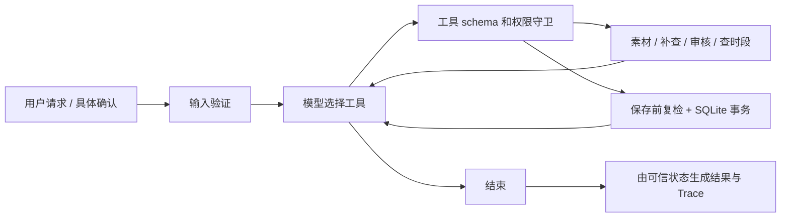

# 素材审核与发布排期 Agent

面向内容团队的审核与排期助手：**模型决定下一步，业务工具守住审核、确认、冲突与保存边界。只保存草稿，不接真实发布。**

使用 Python 3.11+ 标准库、SQLite 和原生 function calling。无需安装 Agent 框架或数据库服务。支持 DeepSeek 真实模型与明确标记的离线 Mock。

## 评审先看这里

1. [验收结果与限制](docs/03-evaluation.md)：六项必验收点、实际文件与回归问题。
2. [真实模型完整 Trace](examples/live/summary.json)：运行结果与逐项断言；每个 `.output.json` 包含输入、实际工具调用、数据库结果。
3. [Agent 循环](src/agent.py)、[可信工具](src/tools.py)、[事务存储](src/storage.py)。
4. [AI 使用披露](docs/04-ai-usage.md)：如实记录 AI 和候选人的工作边界。

## 3 分钟运行

在仓库根目录，使用 Python 3.11 或更高版本：

```bash
python --version
python -m src --input examples/input_normal.json
python -m src --input examples/input_conflict.json
python -m unittest discover -s tests -v
```

本机 PowerShell 可直接运行 `./run.ps1 --input examples/input_conflict.json`；启动器优先使用本地 Python，也可使用已有 Codex Python 环境。

无需 `pip install`；`requirements.txt` 说明运行与测试均只使用标准库。Windows 如没有 Python，请先安装 Python 并启用 PATH。默认数据库是 `runtime/drafts.sqlite3`，被 Git 忽略。

冲突示例中，18:00 已被占用：

```json
{
  "run_status": "waiting_confirmation",
  "requested_time": "18:00",
  "suggested_time": "19:00",
  "scheduled_time": null,
  "confirmation_status": "pending",
  "draft_status": "not_saved",
  "published": false
}
```

原要求保留为 18:00。替代时间只是建议，未获得确认不保存。

## 真实 DeepSeek 模式

复制 `.env.example` 为 `.env`，在本机填写密钥。不要上传 `.env`。

```dotenv
LLM_BASE_URL=https://api.deepseek.com
LLM_MODEL=deepseek-flash
LLM_API_KEY=your-local-key
```

模型名应以自己账号支持的模型为准。本项目实际验证使用 `deepseek-flash`，Chat Completions/function calling 接口；关闭 thinking，Trace 只保存动作依据，不保存模型内部思维。

```bash
python -m src --mode live --input examples/input_conflict.json --output runtime/live-conflict.json
```

真实模式每一步都调用模型选择工具，再把真实工具结果返回模型；没有把固定决策日志冒充模型决策。接口失败明确返回失败，**不会自动降级到 Mock**。默认每项请求最多 12 次决策，每次 HTTP 超时 45 秒，CLI 可用 `--max-steps` 调整，范围 1–50。

## 用户确认与重复提交

从冲突输出的 `result.pending_items` 复制具体建议的 `proposal_id`。只有用户同意这个日期、渠道和替代时段后，才能执行：

```bash
python -m src --input examples/input_conflict.json --approve-time 19:00 --proposal-id proposal-2cf918c6a9a52cb7d78a6d69
```

此 ID 对应仓库中的 `req-conflict` 演示请求。修改输入后必须使用新输出中的 ID。可增加 `--mode live` 让真实模型继续处理。

重复执行同一确认命令只得到同一份草稿：`draft_status=duplicate`，数据库中仍然只有一行。`examples/input_conflict_confirmed.json` 是**模拟用户已确认的测试输入**，不能当成当前真实用户授权。

如果 19:00 随后也被占用，原确认不允许自动改成 20:00，必须重新请求确认。已保存草稿后来遇到占用冲突会返回 `existing_conflict`，保留原草稿供人工处理，不自动追加第二份。

## 复现全部验收

```bash
python -m scripts.generate_examples --mode offline --output runtime/review-offline
python -m scripts.generate_examples --mode live --output runtime/review-live
python -m src --input examples/input_save_failure.json --save-failure --db runtime/failure-demo.sqlite3
```

第二条会实际调用模型、产生 API 费用。评估器对每个场景使用独立临时数据库，可重复运行，不依赖旧运行状态。

保存失败在 INSERT 后、COMMIT 前注入，事务回滚；输出 `failed` 而不是成功。CLI 退出码：`0` 表示本轮得到明确业务结果（含待确认、待补充、阻断）；`2` 表示输入/模型/工具失败；`3` 表示达到步数上限。请同时检查 `run_status` 和 `draft_status`，不能只看退出码判断“排期成功”。

## 输入与输出

```json
{
  "request_id": "campaign-001",
  "material_id": "M01",
  "date": "2026-11-01",
  "required_time": "18:00",
  "channel": "main",
  "timezone": "Asia/Shanghai"
}
```

也可传 JSON 数组，CLI 顺序处理各项请求，共用数据库防止素材间抢占。当前所有时间要求都视为硬性要求，时区限定上海。缺少必要请求字段时直接报错；素材本身资料缺失会进入补查/待资料路径。

结果包括 `review_status`、`risk_reasons`、`scheduling_conflicts`、`suggested_time`、`pending_items`、`confirmation_status`、`draft_status` 与 `draft_id`。`trace` 包含模型动作、参数、工具结果、简短依据和实际下一动作。最终结果由工具状态生成，不采纳模型自由文本中的“成功”声称。

## 结构与设计

```text
src/                  模型适配、Agent 循环、请求验证、工具、SQLite、CLI
scripts/              可复现的验收材料生成器
tests/               业务、并发、越权、模型协议和 CLI 测试
examples/offline/     Mock 实际运行证据
examples/live/        真实 DeepSeek 运行证据
examples/regressions/ 首轮失败证据与修复说明
data/                合成素材、补充库、审核规则、已有时段
docs/                需求、方案、评估、AI 披露、复盘
```



## 范围与限制

这是考核原型：素材和排期数据是合成数据；规则检查基于元数据标签，不包含图片/视频语义审查；没有身份认证、多租户、分布式排期或真实发布。CLI 操作者是可信授权人，proposal ID 用于精确绑定而非身份认证。上线需要认证审批记录、外部排期源的事务/版本控制、草稿取消与改期接口、人工标注的真实评估集。详见 [设计取舍](docs/02-solution.md)。
